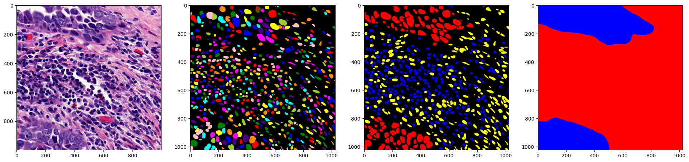

# Getting started

## 1. Load a pre-trained model

Pre-trained weights can be found on the [histolytics model hub](https://huggingface.co/histolytics-hub) or downloaded automatically when calling `from_pretrained`. Make sure you have an internet connection for the first use.

Available segmentation model architectures are:

- `CellposePanoptic`
- `HoverNetPanoptic`
- `StarDistPanoptic`
- `CellVitPanoptic`
- `CPPNetPanoptic`


```python
from histolytics.models.cellpose_panoptic import CellposePanoptic
# from histolytics.models.hovernet_panoptic import HoverNetPanoptic
# from histolytics.models.stardist_panoptic import StarDistPanoptic


model = CellposePanoptic.from_pretrained("hgsc_v1_efficientnet_b5")
# model = HoverNetPanoptic.from_pretrained("hgsc_v1_efficientnet_b5")
# model = StarDistPanoptic.from_pretrained("hgsc_v1_efficientnet_b5")
```

## 2. Run inference for one image
```python
from albumentations import Resize, Compose
from cellseg_models_pytorch.utils import FileHandler
from histolytics.transforms import MinMaxNormalization

model.set_inference_mode()

# Resize to multiple of 32 of your own choosing
transform = Compose([Resize(1024, 1024), MinMaxNormalization()])

im = FileHandler.read_img(IMG_PATH)
im = transform(image=im)["image"]

prob = model.predict(im)
out = model.post_process(prob)
# out = {"nuc": [(nuc instances (H, W), nuc types (H, W))], "cyto": None, "tissue": None}
```

## 2.1 Run inference for image batch
```python
import torch
from cellseg_models_pytorch.utils import FileHandler

model.set_inference_mode()

# dont use random matrices IRL
batch = torch.rand(8, 3, 1024, 1024)

prob = model.predict(im)
out = model.post_process(prob)
# out = {
#  "nuc": [
#    (nuc instances (H, W), nuc types (H, W)),
#    (nuc instances (H, W), nuc types (H, W)),
#    .
#    .
#    .
#    (nuc instances (H, W), nuc types (H, W))
#  ],
#  "tissue": [
#    (nuc instances (H, W), nuc types (H, W)),
#    (nuc instances (H, W), nuc types (H, W)),
#    .
#    .
#    .
#    (nuc instances (H, W), nuc types (H, W))
#  ],
#  "cyto": None,
# }
```

## 2.2 Reconstruct supplied prediction maps

Reconstruction can run without a model instance when prediction maps are already
available. Use the existing processor and select the algorithm that produced the
auxiliary maps:

```python
from cellseg_models_pytorch.inference.post_processor import PostProcessor

processor = PostProcessor("hovernet")
out = processor.postproc_serial(prediction_maps)
```

`prediction_maps` uses the same `nuc`, `cyto`, and `tissue` keys as `model.predict`.
Type maps contain class IDs with shape `(B, H, W)`; auxiliary channels depend on
the algorithm. Serial processing supports absent cytoplasm/tissue outputs as
`None`. Instance results are `(instance_labels, class_labels)` arrays, while tissue
results are class-label arrays. Supplying save paths writes geometry and returns
`None` for those entries. `coords` supplies pixel offsets; class dictionaries map
IDs to names for saved geometry. Set the relevant smoothing callback to `None`
to disable geometry smoothing, or pass a callable to change it explicitly.
For asynchronous processing, callbacks must be pickleable module-level functions;
locally defined functions and lambdas are not supported by the published queue.

The published asynchronous processor requires tissue maps and leaves cytoplasm
results unresolved. Use the serial path for those standalone cases until the
upstream contract is corrected.

## 3. Visualize output
```python
from matplotlib import pyplot as plt
from skimage.color import label2rgb

fig, ax = plt.subplots(1, 4, figsize=(24, 6))
ax[0].imshow(im)
ax[1].imshow(label2rgb(out["nuc"][0][0], bg_label=0))  # inst_map
ax[2].imshow(label2rgb(out["nuc"][0][1], bg_label=0))  # type_map
ax[3].imshow(label2rgb(out["tissue"][0], bg_label=0))  # tissue_map
```

